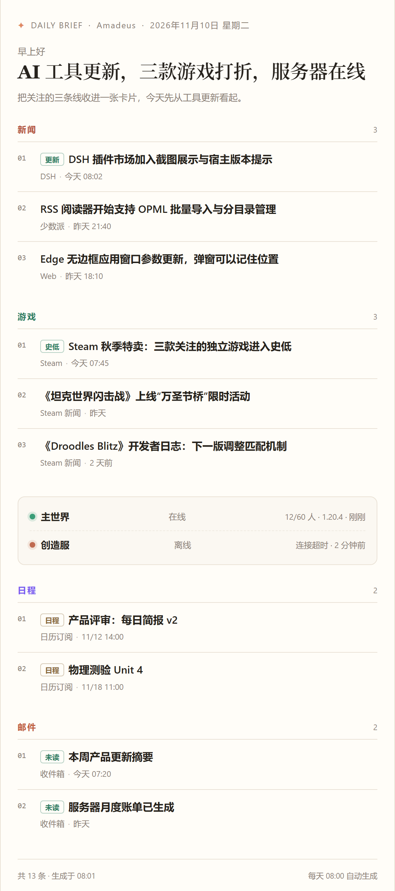
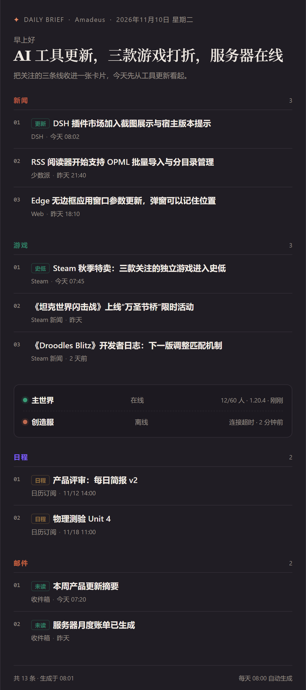

# 每日简报 · Daily Brief v2

给 DeepSeek Harness（DSH）用的每日简报插件：每天定时把你**主动关注**的几件事——X 上的账号、RSS/网页、YouTube 与哔哩哔哩更新、Steam 库里在玩的游戏、你自己的服务器或监控页——整理成一张窄卡片，并以桌面小窗口弹出，像记事本那样出现在屏幕角落，而不是发一条系统通知。

它刻意做得「少而准」：默认没有任何信息流，也不替你猜兴趣。装好后由你贴 ID 决定看什么：X 账号 ID、Steam appid（或从本机库勾选）、自己的服务器与监控地址；一个都不填时，简报会提示去哪里添加。

## 截图





## 特性

- **不限条数**：当天抓到多少事件就显示多少条，不再有 10 条总预算或固定配额；新闻、游戏、学校通知、邮箱、日历、视频更新各自有多少列多少，服务器状态仍单独放底栏。
- **只列你要的**：新闻只抓你粘贴的 X 账号 ID 和订阅源，游戏只抓你选的 Steam appid，没有 Hacker News、IGN 这类大范围聚合；不预置任何账号、订阅或游戏。
- **要点式排版**：每条一个短要点（谁做了什么/有什么变化），带人设语气，不挂原始链接；要点条数跟当天条目走，不设上下限。没配新闻来源时退回把标题提炼成要点。
- **内置四种人设 + 自定义卡片**：鲸鱼娘、助手、管家、军官；自定义卡片可保存多张（最多 12 张），每张有自己的名字、一句话、主色和语气。
- **本地 Steam 库发现**：安装后自动读取本机 Steam 已安装列表，在面板里勾选即可，不用手抄 appid。
- **服务器由你定义**：`地址:端口`、`minecraft://`、`http(s)://` 监控页都行；内网、IP、非标准端口同样支持。
- **桌面弹窗**：独立 Edge/Chrome `--app` 窗口，无地址栏、无标签页，默认右下角 560×860。
- **一页面板**：今天、简报风格、关注范围、来源、节奏、往期；改完即时保存，没有「保存」按钮。
- **打开即显示**：面板先画出上一次的简报与配置快照，再在后台刷新；Windows 计划任务状态改为后台缓存，不再让首屏等 PowerShell 查询。
- **壁纸透出**：检测到 DSH 壁纸引擎（`data-we-wallpaper` / 玻璃层）时，卡片自动变成半透明磨砂玻璃；普通主题仍是原来的深色纯色。
- **不依赖 DSH 常开**：Windows 计划任务会在后台生成并弹出窗口。

## 环境要求

- Windows 10/11（弹窗与计划任务依赖 Windows；其他平台只能生成 HTML）。
- DeepSeek Harness 核心 **≥ 0.2.1-rc.3**（已声明 `engines.dsh`，在 0.2.2-rc.1 上验证）。
- 已安装 DeepSeek Harness，并能用 `plugin_manager` 安装本地插件目录。
- 本机有 Microsoft Edge 或 Google Chrome（用于独立窗口）。
- Node.js 20+（随 DSH 提供；跑测试也用它）。

## 安装

1. 在 DSH 对话里让 agent 用 `plugin_manager` 的 `install_bundle` 安装 npm 包 `dsh-daily-brief`；本地开发时也可以直接指向本目录。
2. 重载 DSH 页面，左侧边栏会出现「每日简报」。
3. 打开面板，插件会自动创建配置目录：`%USERPROFILE%\.dsh\storages\daily-brief\`。

## 首次使用

1. **简报风格**：点一张人设卡。卡片下方会列出这张卡的约束（例如军官卡「动词开头、每条 ≤24 字」）。要自己的风格就点「新增卡片」，填好后点「保存卡片」；保存后可以继续新增下一张。
2. **关注范围 → X 账号**：粘贴你想看的账号 ID（`OpenAI`、`@AnthropicAI` 都行），一行一个；插件不预置任何账号，新闻板块由这些 ID 与订阅源决定。也可以直接粘贴 RSS/Atom 订阅地址，同样归入「新闻」。
3. **关注范围 → 在玩的游戏**：点「从 Steam 库选择」，勾选本机已安装的游戏；也可以直接填 appid。
4. **关注范围 → 服务器与监控**：自己填，例如 `play.example.com:25565`、`192.168.1.20:8123` 或 `http://status.example.com/`。插件不会预置任何服务器。
5. **节奏**：确认每天生成时间（默认 07:30）和「生成后弹出窗口」。
6. 点「立即生成」看效果。之后每天到点自动生成；同一天只生成一次。

## 关注范围

| 类型 | 输入示例 | 行为 |
| --- | --- | --- |
| X 账号 | `OpenAI`、`@AnthropicAI` | 读公开 syndication 时间线，不需要登录；被限流时改用该账号的官方博客 RSS 补位，并显示上次缓存 |
| Steam 游戏 | `502500`，或「从 Steam 库选择」 | 读 Steam 官方新闻接口；连不上时回退到上次成功结果 |
| Minecraft 服务器 | `play.example.com:25565`、`minecraft://mc.example.net` | 原生 Java 状态协议（含 SRV），失败再走 mcstatus.io；离线时底栏写明「离线」 |
| 监控页 / 内网服务 | `http://host:port/`、`10.0.0.5:9000` | 当成「状态来源」记录在线状态与响应时间；内网与 localhost 会自动允许 |

- 条目按时间倒序，超出关注窗口的旧消息不会混进来。
- RSS/Atom、JSON 订阅和网页抓取默认归入「新闻」板块；只有明显带游戏关键词的订阅才归入「游戏」。
- 服务器与监控只占底栏，加多少个都不挤占正文条目。

## 人设卡片

简报页头的名字、问候语、强调色以及 AI 润色的语气，都来自选中的卡片。

| 卡片 | 风格 | 主要约束 |
| --- | --- | --- |
| 🐋 鲸鱼娘 | 蓝色鲸鱼少女，聪明但懒，傲娇又甜 | 称你为「主人」、自称「本鲸」、只说简体中文、绝不承认胖、素材不足会直说 |
| 🗂 助手 | 先结论、后背景，不讲废话 | 短句、不寒暄、标注不确定、只整理事实 |
| 🎩 管家 | 正式、周到，像一份晨间汇报 | 称「您」、结论 → 要点 → 留意、不用感叹号 |
| 🎖 军官 | 作战简报：动词开头，数字优先 | 每条尽量 ≤24 字、时间与数字优先、不对上级提问 |
| 🎨 自定义 / 自建卡片 | 名字、语气、颜色都由你定 | 名字（24 字内）、一句话签名、主色 `#rrggbb`、语气提示词（2000 字内） |

选中即保存。人设只影响文案与配色，不影响抓取范围。

要自己的风格：点卡片网格末尾的「＋ 新增卡片」，填写名字、一句话、主色和语气，然后点「保存卡片」。保存后这张卡会出现并选中；之后可以继续点「新增卡片」加下一张，最多 12 张。自建卡片可以随时重新打开修改或删除；升级前的「自定义」槽仍保留，旧人设不会丢。

## 更多来源：邮箱、学校、飞书、订阅

面板的「添加来源」支持一次粘贴多行地址，先「识别」再勾选「加入」。

| 粘贴的内容 | 识别结果 |
| --- | --- |
| `you@gmail.com`、`me@school.edu` | 邮箱（IMAP）。Gmail 用应用专用密码；学校邮箱识别不出服务器时会多出一个 IMAP 服务器输入框 |
| `me@outlook.com`、`me@hotmail.com`、`me@live.com` | 不再要求 Azure：给出一张「转发到 Gmail / QQ」的三步指南；按指南把 Outlook 邮件转发过去，再添加接收邮箱即可。Outlook 日历则直接粘贴发布的 ICS 链接 |
| `https://youtube.com/@频道`、`https://youtu.be/视频ID`、播放列表 | YouTube 更新（频道 RSS / 视频页），不需要登录 |
| `https://space.bilibili.com/UP主ID`、`https://bilibili.com/video/BV…`、排行榜 | 哔哩哔哩更新（UP 主投稿 / 单个视频 / 排行榜），公开接口，无需登录 |
| `https://…/feed.xml`、`.ics`、任意网页 | 订阅源 / 日历 / 网页。普通网页会自动判断是「单篇文章」还是「列表页」：文章提取标题、正文摘要与发布时间；列表页提取最近条目，抓不到时提示设置 CSS 选择器 |
| `https://www.managebac.com/...`、`https://…managebac.cn/...` | ManageBac 通知（.com / .cn 及学校子域；需要登录 Cookie，或日历订阅链接） |
| `https://…feishu.cn/docx|wiki|calendar/...` | 飞书文档 / 知识库 / 日历；前端渲染抓不到时建议用 ICS 订阅 |
| `http://status.example.com/` | 服务器监控来源 |
| `10.0.0.5:9000`、`192.168.1.20:8123` | 同时给出 Minecraft 与 HTTP 监控两个候选，自己勾选 |
| Steam 商店或新闻链接 | 自动取 appid |

- 密码、授权码、Cookie 保存在本机 DPAPI 加密的 secrets 文件里（`…\daily-brief\secrets\`），不写进 `config.json`。
- 网页类来源会自动带上你填的 Cookie 再抓取。
- 不限条数：当天每个板块抓到多少就显示多少，不再按 10 条预算分配，也不再把新闻挤成 4–5 条；服务器状态单独在底栏，不占正文条目。
- 「来源」卡可以逐个测试、启停、删除；缺登录信息时该行会出现「未填 Cookie / 未填密码」和「补填」按钮，高级 Graph 来源则显示「未连接 Microsoft」和「连接」按钮，就地处理即可，不用删除重加。
- 删除来源会同时清掉该来源保存的密码/Cookie。

### ManageBac 要填什么

两种接法，任选一种：

1. **日历订阅（推荐，不需要登录状态）**：打开 ManageBac →「日历 / Calendar」→ 复制 ICS 订阅链接（通常带一串访问口令）→ 粘贴到「添加来源」。识别为日历来源，每天直接读事件（默认看未来 30 天，可用 `options.daysAhead` 调整到 1–120 天）。
2. **网页通知（要 Cookie）**：粘贴学校 ManageBac 的网址（如 `https://www.managebac.com/student/`）→ 识别为「ManageBac」→ 在 Cookie 输入框里粘贴登录 Cookie（浏览器登录后按 F12 → Network → 刷新 → 点任意请求 → 复制 Request Headers 里 `cookie` 冒号后的整段值）。也可以先留空加入，之后在「来源」卡里点「补填」。

Cookie 只保存在本机加密文件里；过期后重新补填一次即可。

### Outlook / Hotmail / Live 怎么办（不需要 Azure）

微软已在 2024-09-16 停用 Outlook.com / Hotmail / Live / MSN 的基本认证，`@outlook.com`、`@hotmail.com`、`@live.com`（含 `.cn`）不能再用「邮箱密码 / 授权码 + IMAP」登录。也**不需要再注册 Azure 应用**：面板识别到 Outlook 地址时，会直接给出一张三步转发指南。两条零配置路线任选：

**路线 A：把 Outlook 邮件转发到一个能收 IMAP 的邮箱（推荐）**

1. 打开 Outlook 网页版 →「设置 → 邮件 → 转发」，填一个 Gmail / QQ 邮箱，按提示完成验证；
2. 在接收邮箱开启 IMAP：Gmail 生成「应用专用密码」，QQ 邮箱生成「授权码」；
3. 回到「添加来源」，粘贴接收邮箱地址，填密码/授权码即可。

- 转发入口：https://outlook.live.com/mail/0/options/mail/forwarding
- 转发会保留原邮件；建议在接收邮箱里加一条过滤规则，只保留真正想看的发件人，避免简报被邮件塞满。
- Outlook 邮件本身只读不到也没关系：插件读的是转发后的接收邮箱，不接触你的 Outlook 密码。

**路线 B：只看 Outlook 日历**

Outlook 日历 →「设置 → 共享日历 → 发布日历」→ 复制 ICS 链接 → 粘贴到「添加来源」。日历事件会直接进入简报的「日历」板块，不需要登录。

**高级：Microsoft Graph 设备代码（可选）**

只有 To Do 任务这类没有转发替代品的来源才需要 Graph：先注册一个 Azure 应用（客户端）ID，再在 `microsoft.com/devicelogin` 输入一次设备代码。普通 Outlook 邮件/日历不需要走这条路，README 也不再把它当作默认方案。

补充：

- 如果之前在旧版本里把 Outlook 邮箱加成 IMAP 或 Graph 来源，删掉它，按上面的转发路线重新添加即可。
- 转发和日历发布都在微软自己的服务器上完成，插件只保存接收邮箱的密码或 ICS 链接，仍然放在本机 DPAPI 加密的 secrets 文件里。

## 桌面窗口

生成后调用本机 Edge（没有则 Chrome）以 `--app=file://…` 打开简报：

- 独立窗口、无浏览器外壳，尺寸与位置可配置（默认 560×860，右下角，也可居中）。
- 使用插件自己的临时配置目录，不影响日常浏览器的登录状态。
- 找不到 Chromium 时回退到默认浏览器打开，不会静默失败。

## 计划任务

插件注册名为 **DSH Daily Brief** 的 Windows 计划任务，含两个每日触发器：

- **准备**：提前 `schedule.prepareLeadMin` 分钟（默认 10 分钟）静默收集并写入当天简报，不弹窗；
- **发布**：到设定时间只做投递（弹窗/邮件/webhook），通常 1–2 秒完成，因此不会因为抓取慢而迟到；
- 错过准备时会在发布阶段现场生成后投递；准备超过发布时间则在同一进程里直接发布；
- 到了准备/发布时间电脑还在关机或睡眠时，下次开机/唤醒会补跑；当天错过的发布立即补发，跨天后不补旧闻，直接准备当天的一期；
- 允许电池供电启动，不会因为拔掉电源而跳过；同一天只发布一次（「立即生成」可强制重跑，且不计入自动生成记录）；
- 面板的「睡眠时唤醒」会打开计划任务的 WakeToRun，电脑合盖睡眠时也能在准备时间醒来。
- 日志：`…\daily-brief\logs\runner.log`。

## AI 润色

- 默认「自动」：仅当本机 DSH 有可用登录时，用 headless 方式让模型写标题、一句引言和两段要点；失败自动回退本地文案。
- 只改文案，不改抓取结果、不增删条目；提示词里明确禁止编造与出现网址。

## 数据与隐私

- 配置、缓存、简报都在 `%USERPROFILE%\.dsh\storages\daily-brief\`；X 与 Steam 缓存位于其中的 `.cache\`。
- 所有抓取只访问你添加的来源与本机 Steam 安装信息，不发遥测。
- 从 v1 升级：旧的 `preset-*` 大范围来源会被移除，手动添加的来源保留；升级后重启一次 DSH 以获得新识别规则与人设字段。

## 常见问题

| 现象 | 处理 |
| --- | --- |
| 面板提示「重启一次 DSH」 | 插件主进程仍是旧代码：完全退出并重开 DSH，面板会恢复可编辑 |
| X 新闻经常很少 | syndication 对同一出口 IP 限流很紧（约每 15 分钟 1 次），插件会自动用官方博客补位；可减少账号数量，或改用 RSS 订阅 |
| Steam 显示「暂时连不上」 | 官方新闻接口偶发超时，会自动显示上次结果；稍后重跑即可 |
| 服务器一直离线 | 确认地址与端口、服务器是否开机；内网地址需允许私有网络（已默认允许） |
| 桌面窗口没出现 | 检查是否安装 Edge/Chrome；查看 `logs\runner.log` 的投递记录 |
| 飞书/ManageBac 抓不到条目 | 多为前端渲染或需要登录：改用日历 ICS 订阅，或在「添加来源」里填入 Cookie |
| Outlook 邮箱填密码后报错 / 连不上 | Microsoft 已停用 IMAP 密码登录，但不再需要 Azure：按上面「Outlook 怎么办」把邮件转发到 Gmail / QQ，再添加接收邮箱；或直接用 Outlook 日历的 ICS 链接 |
| 插件市场里安装失败，任务日志是 `pnpm` 且提到 `@napi-rs/canvas-*` / `@img/sharp-*` 或 `EPERM`/`EBUSY` | 失败发生在市场对整个 DSH profile 做 pnpm 重解析时（删宿主自带的原生可选包，被运行中的 DSH 占用），与插件包无关。完全退出 DSH（含托盘）后重装；仍失败就在终端执行 `dsh plugin add dsh-daily-brief` 取真正的错误行 |

## 配置参考（`config.json`）

- `sources[]`：`type`（x/steam/minecraft/http/rss/atom/json/ics/page/youtube/bilibili/imap/graph/browser/managebac）、`section`、`label`、`enabled`、`options`。
- `graph.clientId`：仅 To Do 等高级 Microsoft Graph 来源需要的 Azure 应用（客户端）ID；普通 Outlook 邮件/日历不用填。
- `persona`：`preset`（whale/assistant/butler/officer/custom 或自建卡片的 id）、`customName`、`customTagline`、`customAccent`、`customPrompt`，以及 `cards[]`（每张 `{ id, name, tagline, accent, prompt }`，最多 12 张）。
- `schedule`：`time`（HH:MM）、`enabled`、`wakeToRun`、`prepareLeadMin`（提前准备分钟数，默认 10）。
- `delivery.popup`：`enabled`、`position`、`width`、`height`、`openOnGenerate`。
- `ai.polish`：`auto` / `off`。

## 开发

```bash
npm test                                      # 单元测试（node --test）
node lib/engine/runner.js --dry-run --force   # 生成但不投递，检查输出
node lib/engine/runner.js --force             # 生成并投递（按配置弹窗）
```

目录结构：

- `lib/engine/`：配置、抓取、渲染、AI、弹窗、计划任务。
- `lib/engine/collect/`：各类来源采集器（x、steam、minecraft、feed、page、youtube、bilibili、http、imap…）。
- `lib/host/`：面板 API、工具注册、计划任务桥接。
- `client.js`：面板 UI（单页）。
- `test/unit.test.mjs`：纯函数与渲染测试。

## 版本与反馈

- 本插件按「每次改动提交一次」维护；仓库地址与提交钩子见 `.githooks/post-commit`。
- 遇到问题请附：生成日期、`logs\runner.log` 相关片段、面板里「来源」卡的测试结果。
